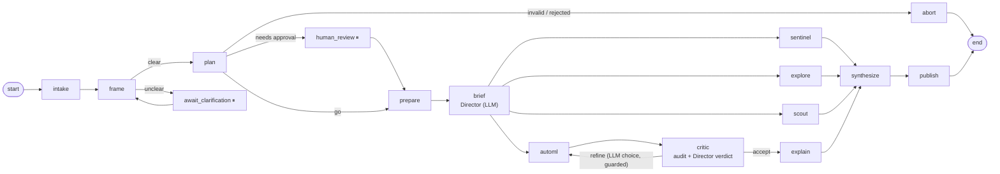

# v6 architecture: a crew, not a pipeline

v5 was a better pipeline. v6 changes the *relationship* between the nodes: four agents work **at the same time**, talk to each other **while they work**, and the judgement calls are made by an **LLM inside deterministic guards**.

## 1. The graph (16 nodes)



| Node | What it is |
|---|---|
| `intake`, `frame`, `plan`, `prepare` | unchanged from v5 (profile, understand request, plan, split data) |
| `await_clarification` ⏸, `human_review` ⏸ | the only two human interrupts |
| **`brief`** | **Director (LLM).** Decides which specialists to deploy, the AutoML budget/workers/style, and extracts a modelling goal stated in plain words. |
| **`sentinel`** | Data auditor. Deterministic scans (leakage, drift, label conflicts, ID-like columns) + an LLM review that decides which suspects to quarantine. |
| `explore` | statistics, KPIs, trends, text/vision analysis (parallel sub-tasks, failure-isolated) |
| **`scout`** | LLM feature-idea generator. Sees column names and summary statistics only; ideas run through a safe DSL. |
| **`automl`** | The goal-driven research lead (section 3). |
| **`critic`** | Deterministic audit, then the Director chooses **accept** or **refine** among the routes the guards allow. |
| `explain`, `synthesize`, `publish` | as v5; `synthesize` now joins all four branches |

## 2. Where the LLM decides and where code decides

| Decision | Who | Guard (always deterministic) |
|---|---|---|
| Is the plan valid? approval needed? | **code** | `plan_errors`, interrupts |
| Which specialists, how much budget, workers | **LLM** (`brief_crew`) | workers ≤ CPUs and `NEXUSML_AUTOML_WORKERS`; user's time limit always wins; scout off for text/image |
| Goal stated in words | **LLM** extracts | `targets.parse` validates; invalid goals are ignored with a warning |
| Which suspect columns to quarantine | **LLM** (`sentinel_review`) | only *high* severity; ≤ 30% of features; the AutoML agent still has to apply it |
| Which experiment next | **LLM** (`automl_round`) | action whitelist; validated against the data; budgets; never repeats a tried idea |
| Stop searching | **LLM proposes** | accepted only with evidence (see below) |
| Accept or refine | **LLM** (`route_verdict`) | `refine` offered only if goal unmet or blockers, refines left, search not already flat |
| Retry budget, interrupts, tracking, persistence | **code** | – |

**Degradation, not death.** If the LLM cannot answer at a decision point, the junction falls back to its deterministic default and records `source: "default"` (and a warning). `NEXUSML_STRICT_LLM=1` makes any failed decision stop the run, like every other LLM call.

**Every decision is recorded** in `state["decisions"]`: junction, source, choice, rationale, and the guard that applied. They appear in the report ("The crew"), the app (Crew tab) and MLflow (`decisions.json`).

## 3. The goal-driven AutoML agent

### What I took from the literature (re-implemented, not copied)
| System | Idea used |
|---|---|
| **FLAML** | search cheap before expensive; choose the learner with probability ∝ 1 / (estimated cost for improvement); local search around the incumbent |
| **auto-sklearn 2.0** | static portfolio warm start; **successive halving** on data size; CV vs holdout by data size; ensembles built from the search |
| **AutoGluon-Tabular** | keep out-of-fold predictions for every model; **ensembling beats picking one winner**; greedy (Caruana) selection as a robust final layer |
| **AIDE** | a tree of solutions improved by typed operators; summarised digest for the LLM; its fixed search policy is the weakness an LLM policy replaces |
| **AutoML-Agent** | specialist agents with a shared plan, running in parallel, with verification |

### The loop
```
portfolio (every family, defaults; successive halving if ≥ 2000 rows)
   │   wait (bounded) for the sentinel
   ▼
ROUND n ─ digest ─▶ LLM ─▶ actions ─▶ guards ─▶ execute (parallel inside) ─▶ credit assignment
   ▲        goal gap · leaderboard · learning curve · noise ceiling · messages from other agents ·
   │        what earlier actions achieved · rejected proposals · budget
   └─ stop?  goal estimate met (and no pending leak) · LLM stop with evidence · plateau (3 flat rounds) · budget · round limit
   ▼
finalize: ensemble (greedy / stack) → refit → RE-SCORE every finalist on fresh folds → held-out scored once
```

**Action menu** (the LLM never writes code): `search_family` (with a validated `space_hint`), `try_recipe` (`power`, `missing_ind`, `target_enc`, `interactions`, `select`), `try_ideas` (safe DSL: ratio, diff, product, sum, log1p, sqrt, square, abs, is_missing, bin_quantile, count_encode, group_mean), `class_weight`, `regularize`, `log_target`, `deepen`, `ensemble`, `drop_features` (sentinel-flagged columns only), `stop`.

**Credit assignment.** Every recipe/idea/flag records its mean effect on the top families; the LLM sees it next round (so it stops repeating what hurt).

### Honest protocol (the answer to "did we reach the goal?")
1. **Search:** k-fold CV on the training split. Optimistic once many configs were tried.
2. **Confirm:** finalists re-scored on **fresh folds** after the search (winner's-curse correction). This number drives the leaderboard and the stop rule.
3. **Test:** the held-out split is scored **once**, at the end, with a bootstrap interval.

Verdicts: `met` (fresh folds **and** held-out), `met_on_test_only` (borderline), `not_met` (with evidence: noise ceiling, plateau, budget; and a note when the held-out interval still contains the target), `no_goal`.

**Stop rules that require evidence:** `goal_met` only if the estimate meets it **and no flagged leak is pending**; `infeasible` only with a noise ceiling below the goal, or two flat rounds with a gap larger than 3 standard deviations; `plateau` only after a flat round.

### Noise ceiling
Rows with identical features but different outcomes cannot be separated by any model. When ≥ 1% of rows are duplicated, the engine computes the best achievable accuracy (or R²) and shows it to the LLM and the report.

### Parallelism
* **Graph level:** `sentinel`, `explore`, `scout`, `automl` run concurrently (verified by recorded start/end times; shown as a Gantt chart in the app).
* **Inside AutoML:** independent trials run on a worker pool (`workers` chosen by the Director, ≤ CPUs). Results are returned in input order, and each trial is seeded, so **the outcome never depends on thread timing** (tested: 1 worker and 3 workers give identical trials).
* Threads are used (sklearn releases the GIL in its heavy loops). On a single-core machine nothing speeds up; correctness is identical.

## 4. The blackboard
LangGraph state merges only when a node *finishes*, so parallel branches cannot see each other through it. The blackboard (`blackboard.py`) is the live channel: the sentinel posts `leakage_suspect` / `quarantine_proposal` / `drift` / `noise_ceiling`, the scout posts `feature_idea`s, explore posts findings, and the AutoML agent reads its inbox at the start of every round. The full conversation is exported to `state["board"]` (audit trail, shown in the app and report).

**Why it matters (a real bug it prevented):** on a dataset with a leaky column just below the profiler's automatic cut-off, v5-style search reached AUC 0.97 and reported "goal met". With the crew, the sentinel flagged the column in parallel, the AutoML agent saw the proposal, dropped it in round 1, and the honest result was AUC 0.68 and "goal not met".

## 5. What changed in the existing code
`modeling.py` (`Spec` carries recipes/ideas; recipe-aware preprocessor/builder; shared `make_baseline`), `critic.py` (uses AutoML's fresh-fold verdict: re-validating a pre-fitted ensemble with a clone would be leaky; warns on a kept leak suspect), `tracking.py` (AutoML params/metrics, trial table, decisions, blackboard artifacts), `reporting.py`, `app.py`, `state.py`, `graph.py`, `stages.py`. The v5 `fit` stage and the retry Strategist are replaced by `automl` and its actions.
